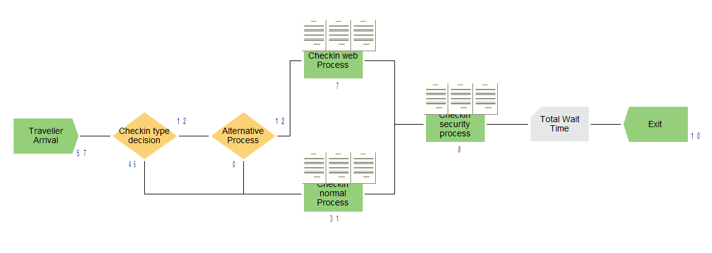
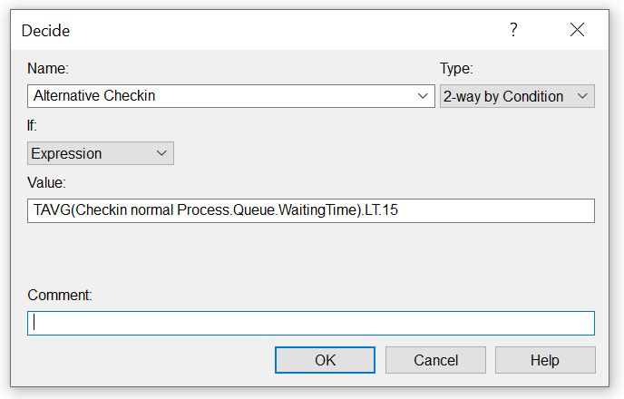

# Airport Check-in and Security: Discrete-Event Simulation

**Simulation for Managerial Decision Making module, Aston University (2025)**
**Tool:** Rockwell Arena (discrete-event simulation)
**Skills:** process mapping, input modelling, simulation build, verification and validation, scenario testing, statistical comparison

---

## The problem

Long check-in and security queues mean missed flights and unhappy passengers. I built a simulation of an airport's check-in and security process to find the bottlenecks, and to test whether a simple supervisor rule would cut waiting times: **redirect passengers when a queue's wait goes over 15 minutes**.

## The model

| Element | Setting |
|---|---|
| Arrivals | Random (exponential), on average 1 passenger every 30 seconds, 180 passengers in total |
| Route split | 75% normal check-in, 25% web check-in (bag drop only) |
| Normal check-in | 8 agents, service time triangular (5, 10, 15) minutes |
| Web check-in | 2 agents, triangular (3, 5, 10) minutes |
| Security | 5 X-ray machines, triangular (2, 5, 10) minutes |
| Run | 4-hour window, check-in closes 30 minutes before departure, **10 replications** |

Built in Arena with Create, Assign, Decide, Process (seize-delay-release, FIFO), Record and Dispose modules. A Decide module with an expression on average queue waiting time applies the 15-minute redirect rule.

## Verification
- Traced passengers with Arena's run-time animation, so I could check the routing and the split was right.
- Checked that resources were being seized and released correctly, and that queue statistics were sensible.
- **180 passengers in, 180 out** in every replication.

## Results

**As-is:** the system worked but was congested.
- Normal check-in waits ran from **30 to 42 minutes** across replications.
- Web check-in waits were 15 to 31 minutes, and security waits 17 to 26 minutes.

**To-be (redirect when wait > 15 minutes, plus extra counters and X-ray capacity at peak):**

| Scenario | Average wait (min) | Std dev | 95% CI |
|---|---|---|---|
| As-is | 40.1 | 6.66 | 35.3 – 44.9 |
| To-be | 36.0 | 4.13 | 33.1 – 39.0 |

The confidence intervals overlapped slightly, so I ran a **paired t-test** across the 10 replications: t ≈ 3.87, p ≈ 0.0012. The to-be scenario cut waiting time significantly, and it was more consistent too (lower standard deviation).

## Recommendations
- **Real-time queue monitoring** that redirects passengers automatically once the average wait passes 15 minutes.
- **Flex staffing and X-ray capacity** at peak times.
- Use **simulation and a live operations dashboard** to test schedule changes before making them.

## Files
- `Airport_Checkin_Simulation_Report.pdf`: full report
- `images/`: model screenshots

----------
